<p align="center">
  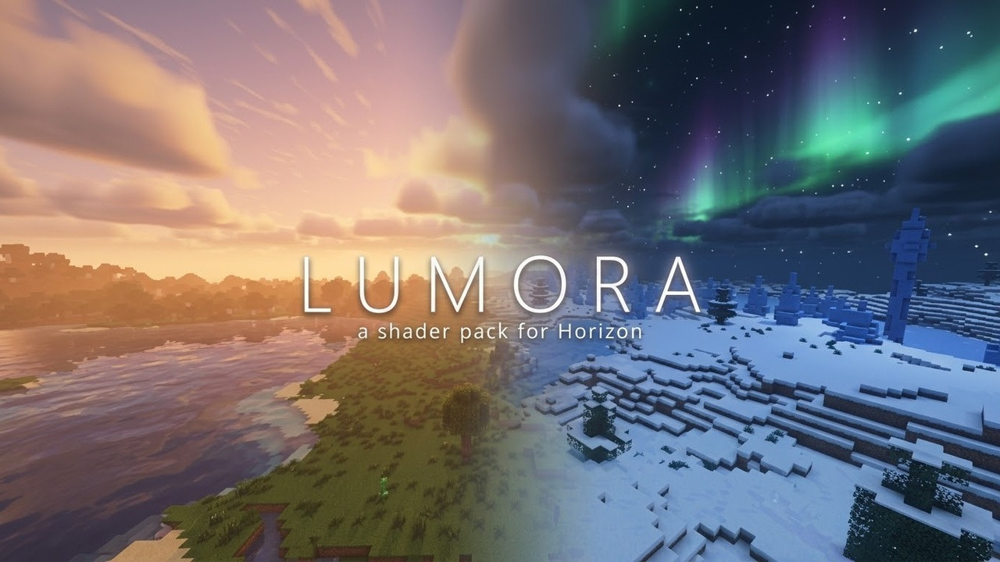
</p>

<h1 align="center">Lumora</h1>

<p align="center">
  <b>A luminous, calm shader pack for <a href="https://playhorizon.dev">Horizon</a>, where every biome has its own light, air and weather.</b><br>
  From a light Low preset for older PCs to a photoreal Max, with optional ray tracing.
</p>

<p align="center">
  <a href="../../releases/latest"></a>
  
  
  
</p>

---

Lumora is a native shader pack for Horizon, written from scratch in WGSL against Horizon's own
shader API. It is not a port of an Iris or OptiFine pack. Its direction is simple: a luminous
Minecraft with one foot in fantasy, built to be **easy on the eyes**. Every scene is lit the way a
sunset is: warm light from one side, cool lilac shade, and something left dark on purpose.

The name blends *luminous* and *aurora*.

## Gallery

<table>
  <tr>
    <td width="50%">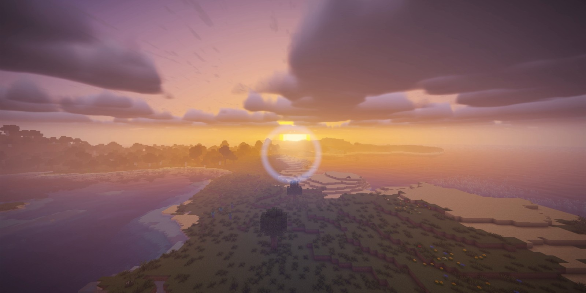<br><sub><b>Golden hour.</b> The sun's glow stays in the far air; the lens catches it.</sub></td>
    <td width="50%">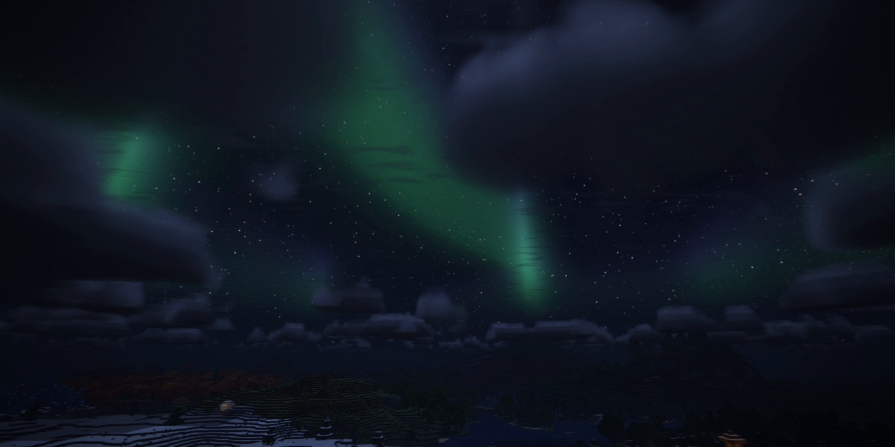<br><sub><b>Northern lights.</b> Green and violet curtains on clear nights in cold biomes.</sub></td>
  </tr>
  <tr>
    <td>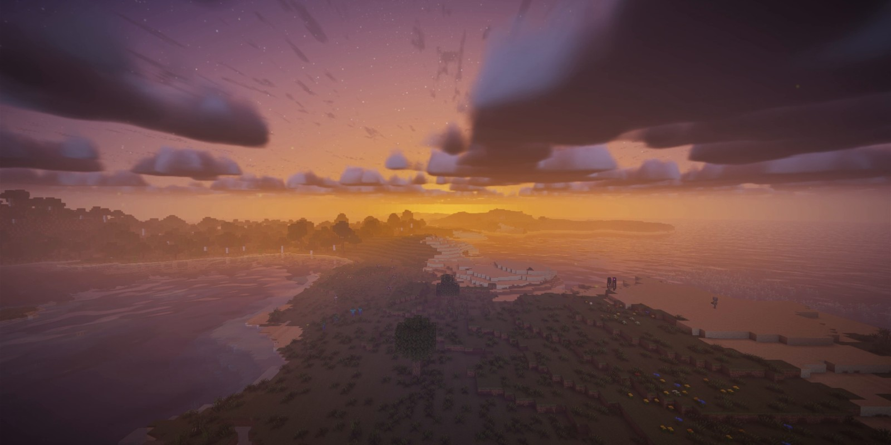<br><sub><b>Sunset.</b> Gold at the horizon, rose in the clouds, the water mirroring both.</sub></td>
    <td>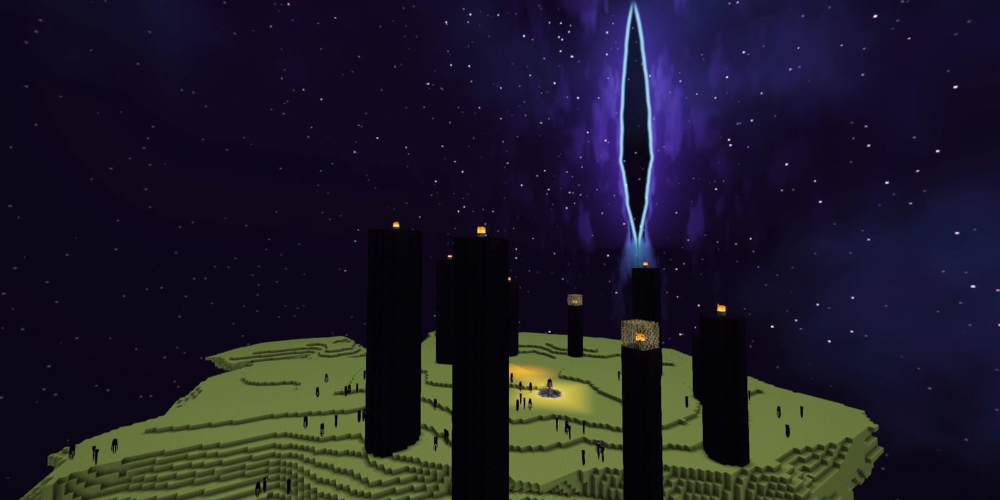<br><sub><b>The End.</b> The Rift, a tear in the violet sky that slowly breathes.</sub></td>
  </tr>
  <tr>
    <td>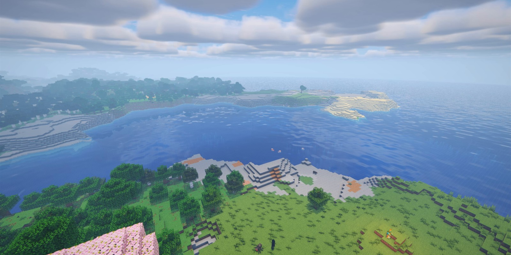<br><sub><b>Cherry coast.</b> Clear, shallow water turning deep blue offshore.</sub></td>
    <td>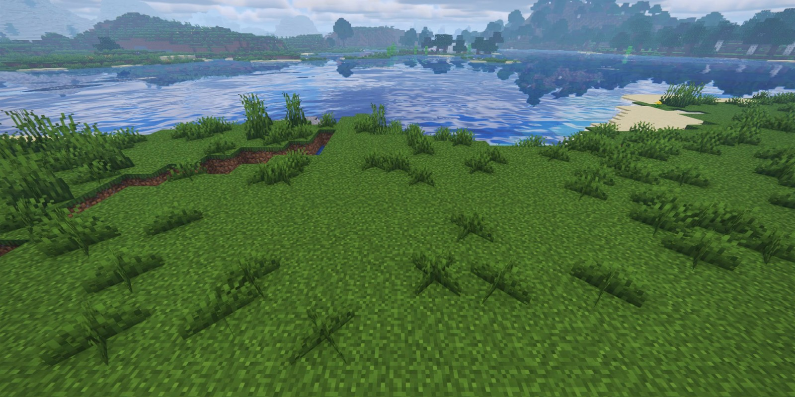<br><sub><b>Still water.</b> Hills, trees and clouds mirrored in the lake.</sub></td>
  </tr>
  <tr>
    <td>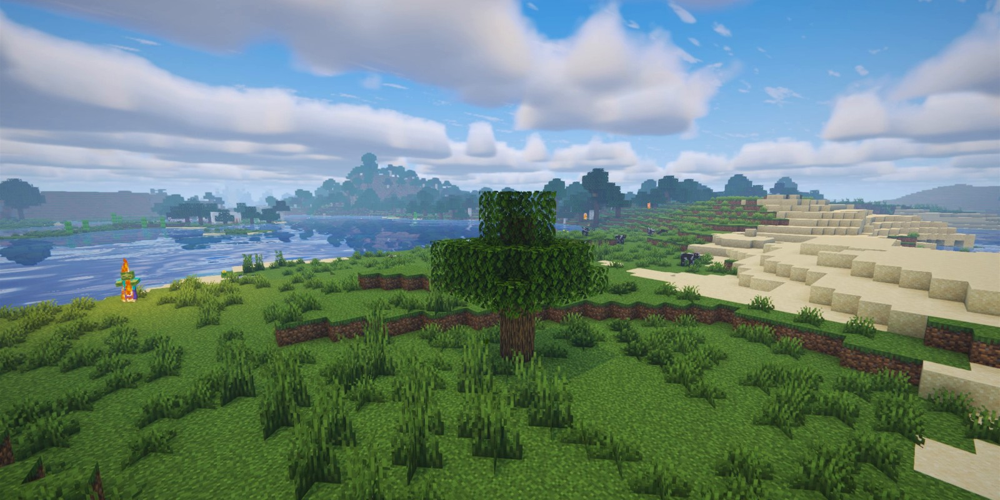<br><sub><b>Daylight.</b> Volumetric clouds, soft haze, crisp shadows.</sub></td>
    <td>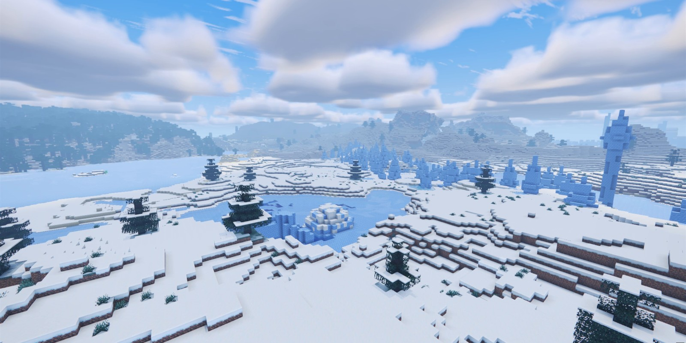<br><sub><b>Snow.</b> Thin, cool, clear air and a colder palette.</sub></td>
  </tr>
  <tr>
    <td>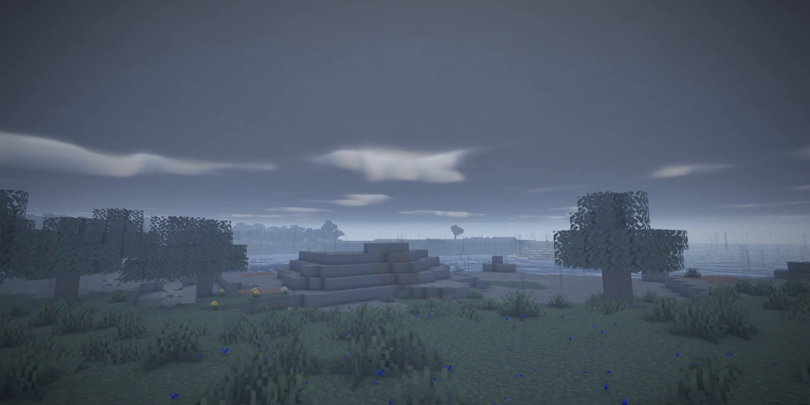<br><sub><b>Rain arriving.</b> Dark cloud bases, a still-bright horizon, the air thinning.</sub></td>
    <td>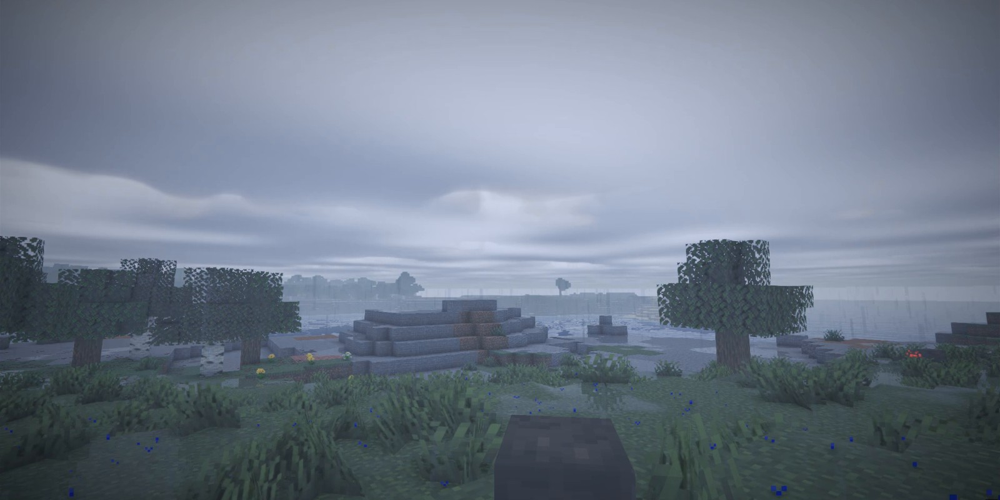<br><sub><b>Thunderstorm.</b> Lightning flashes light the clouds and the land.</sub></td>
  </tr>
  <tr>
    <td>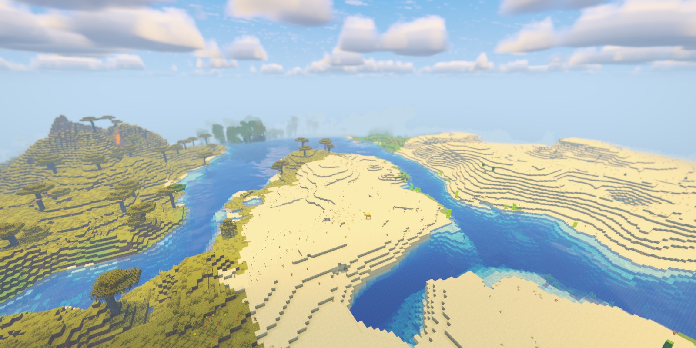<br><sub><b>Desert.</b> Warm dust in the air and a hotter, whiter sun.</sub></td>
    <td>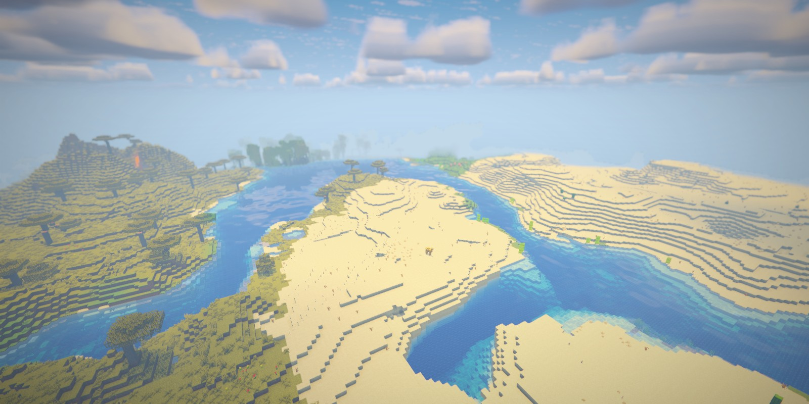<br><sub><b>No rain in the desert.</b> Taken while the world was raining: deserts, savannas and badlands stay dry.</sub></td>
  </tr>
  <tr>
    <td>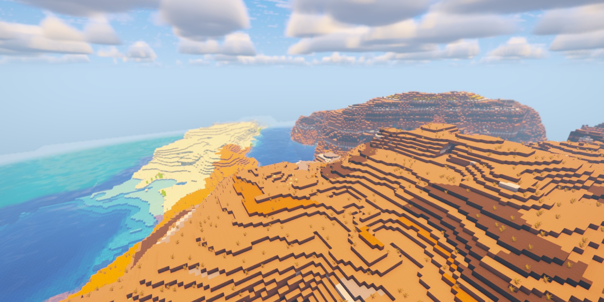<br><sub><b>Badlands.</b> Each land has its own colour, air and sun.</sub></td>
    <td>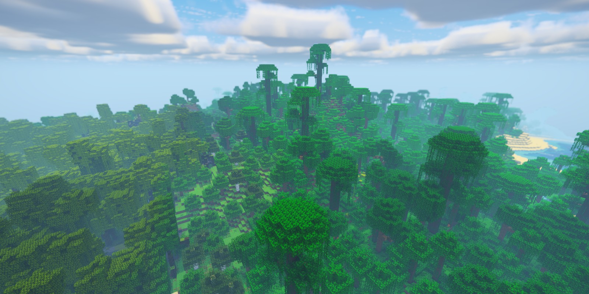<br><sub><b>Jungle.</b> A green, steamy haze and softer, filtered light.</sub></td>
  </tr>
  <tr>
    <td>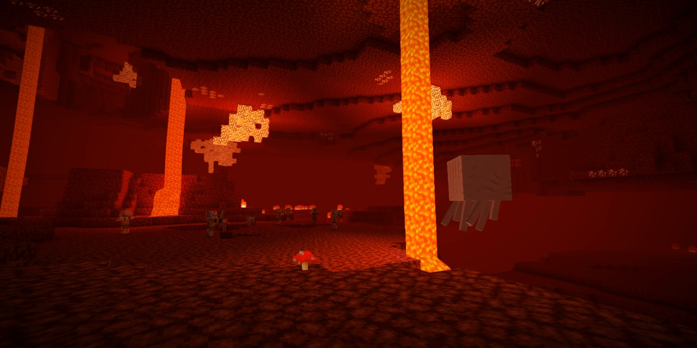<br><sub><b>The Nether.</b> Lavafalls, glowstone and shimmering hot air.</sub></td>
    <td>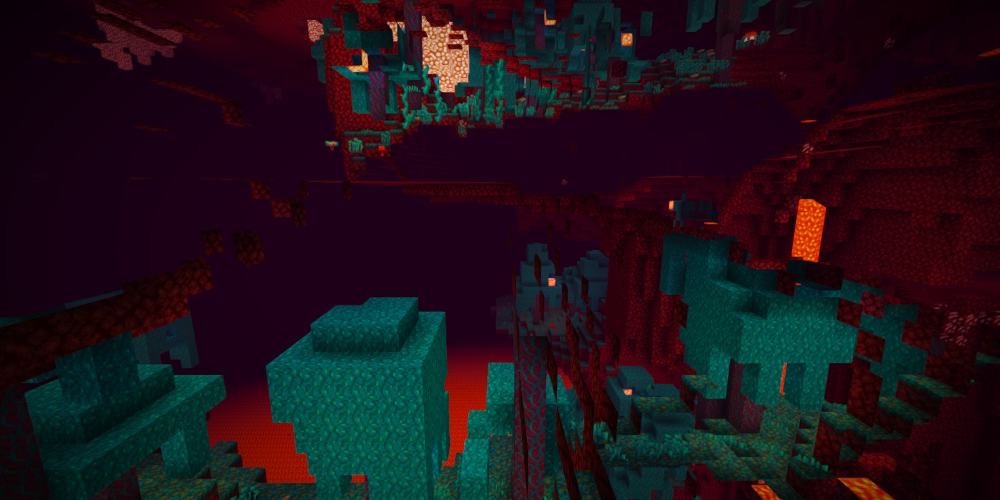<br><sub><b>Warped forest.</b> Every Nether biome tints the picture with its own fog.</sub></td>
  </tr>
  <tr>
    <td colspan="2">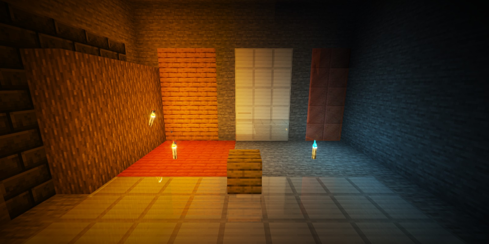<br><sub><b>Torchlight.</b> Block light takes the colour of what makes it: warm torches, blue soul fire, gold lanterns.</sub></td>
  </tr>
</table>

## Install

Lumora is a **Horizon shader pack** (a `.hshader` file). It runs in [Horizon](https://playhorizon.dev),
the Rust Minecraft client, not in Java Edition with Iris or OptiFine.

### What you need

| | |
| --- | --- |
| **Game** | Horizon, **Nightly 2026-11-18 or newer** (shader API 0.2) |
| **Minecraft version** | 26.3, the version Horizon plays |
| **GPU** | any GPU that runs Horizon; Low for older or integrated GPUs, ray tracing only on GPUs with ray queries (RTX-class) |
| **File** | `lumora-1.3.0.hshader`, about 66 KB |

Horizon ships only Nightly builds, and the launcher installs the newest one by itself. If you
installed Horizon a while ago, open the launcher once so it updates before you add Lumora.

### Step by step

**1. Download the pack.**
Go to the [latest release](../../releases/latest) and download **`lumora-1.3.0.hshader`**.
Don't unzip it and don't rename it: the game reads the file as it is.

**2. Add it to Horizon.** Pick one of these:

- **Drag and drop (easiest):** open the Horizon launcher, select the instance you play, and drag
  `lumora-1.3.0.hshader` onto the launcher window. It goes straight into that instance's
  `shaderpacks/` folder.
- **From the game:** go to **Options > Video Settings > Shaders > Shader Packs...**, click
  **Open Pack Folder**, and copy `lumora-1.3.0.hshader` into the folder that opens.
- **From a terminal:** `horizon-launcher packs add lumora-1.3.0.hshader`, then
  `horizon-launcher packs on Lumora --kind shader`.

**3. Turn it on.**
Start the game and go to **Options > Video Settings > Shaders > Shader Packs...**. Lumora is in
the list, marked **(Horizon)**. Click it once to turn it on (click it again to turn it off). Only
one shader pack runs at a time.

**4. Choose a preset.**
Open **Shader Options...** at the top of the same page. You land on Lumora's start page: pick a
**Quality preset** (see the table below). High is the default; start lower on a laptop or an
older GPU. Every option on the other pages (Lighting, Surfaces, Sky, Weather, Water, Picture) has
a one-line description: hover it to read what it does.

**5. Play.**
The first load of a world with Lumora takes a second or two longer while the pack is built.

### Updating

Download the new `.hshader` from the releases page, add it the same way, and pick the new version
in the Shader Packs list. You can delete the old file from `shaderpacks/` afterwards.

### Troubleshooting

| What you see | What to do |
| --- | --- |
| Lumora is not in the Shader Packs list | Check that the file is in the `shaderpacks/` folder of the instance you are playing, and that it still ends in `.hshader`. |
| The chat says the pack *needs shader API 0.2* or lists problems in the pack | Your Horizon is older than the 2026-11-18 Nightly. Open the launcher and let it update, then try again. |
| Low frame rate | Pick a lower preset. The biggest gains: **Shadow sharpness** at 2048, then **Shadows** off. Keep Ray tracing **Off**. |
| Ray tracing does nothing | Your GPU or Horizon backend has no ray queries. Lumora falls back to its screen-space effects; leave Ray tracing Off. |
| The picture is too bright, too dark or too colourful | **Picture** page: Brightness and Colour. **Sky** page: Haze. |
| Something looks wrong | Open an [issue](../../issues) with a screenshot taken with **F3** open (it shows your position and GPU) and your preset. |

## What it does

### Light
- **Sun and moon shadows** from a shadow map, coloured where light passes through stained glass or
  water. On Max, shadow edges are sharp where an object touches the ground and soften with
  distance, the way real sunlight does.
- **Sky light** from above, and **block light in the colour of its source**: warm torches, blue
  soul fire that really paints the stone blue, red redstone, gold lanterns.
- **Contact shade** (ambient occlusion) in corners, under walls and between blocks, in two styles:
  Classic, or Accurate (GTAO).
- **Bounce light** on Max: lit surfaces pass their colour on to the walls round them, so a room
  fills with soft, warm light.
- **Materials that read differently:** stone is rough and turns glossy in rain, wood is warm and
  soaks dark, metal shines in its own colour and beads with water. Flames, lamps and lava glow
  from their brightest pixels; ores sparkle faintly.

### Sky
- A sky of its own: blue overhead and pale at the horizon, gold and rose round a low sun, navy at
  night with twinkling stars and a Milky Way that turn with the sky.
- **Volumetric clouds** lit by the sun or the moon, built up over frames to stay smooth and cheap,
  with grey bottoms and bright edges toward the sun; their shadows drift over the land. Far above
  them, a **high veil** of cirrus that turns gold at sunset and thickens ahead of rain.
- **Haze** that thickens with distance and in valleys, **light shafts** through trees and haze,
  ground mist at night and at dawn.
- **Night, one lead at a time.** The northern lights over cold biomes take the whole sky; otherwise
  the moon; and on moonless nights the Milky Way. Fireflies blink on warm nights, and now and then
  a shooting star crosses the sky.

### Biomes and weather
- **Rain falls only where the biome allows it.** Deserts, savannas and badlands stay dry under a
  rainy sky, and cold biomes get snow instead.
- **Every land has its own air:** warm dust over sand and savanna, a green, steamy haze over jungles
  and swamps, thin cool air in the cold, each with its own sunlight and colour.
- **Smooth transitions.** Walking from one biome into another fades the haze, the wet ground, the
  clouds and the northern lights over a few seconds instead of snapping.
- **Four weather moments you can tell apart:** rain arriving (dark bases over a bright horizon),
  rain (a wet, glossy foreground with puddles mirroring the sky and drops ringing on water), storm
  (darker, lit by lightning inside the clouds), and after the rain (clearer air, broken clouds and
  a rainbow opposite the sun).
- **Snow** whitens what faces the sky in cold biomes, more while it snows.

### Water
- **See into it:** the bed bends with the ripples, shallows stay turquoise with foam on the shore,
  deep water goes dark blue-green. Water clarity is adjustable.
- **A mirror** of the land and the same sky you see, clouds and all, broken up by a gentle swell.
- **Caustics:** a web of light plays on whatever lies under the water.
- **Underwater:** the bed keeps its colours close by, the murk hides the distance, and looking up
  the sky shows through a round window.

### The Nether and the End
- **The Nether:** shimmering hot air, and each biome (crimson, warped, soul sand valley, basalt
  deltas, wastes) tints the picture with its own fog colour.
- **The End:** a violet sky with the **Rift**, a tall, narrow tear low in one part of the sky, its
  ragged edges burning pale teal, slowly breathing, with threads of light drifting into it.

### Camera
Motion blur, background blur (the far distance softens like a lens focused near), optional focus
blur, a lens flare toward the sun, a subtle colour fringe, a three-layer glow, a soft tone curve
that never burns to white, and FXAA.

### Ray tracing (optional)
On a GPU and Horizon backend with ray queries (RTX-class cards):
- **Reflections + shadows:** traced reflections and contact shadows, about +1 ms.
- **Full:** adds two traced bounces of light at half resolution with reprojected history.

When ray tracing is unavailable, Lumora keeps its screen-space paths and nothing breaks.

## Quality presets

Each preset switches whole effects on or off, not just their sample counts. Every effect also has
its own setting, and the preset only turns off what its level can't afford.

| Preset | For | What it adds |
| --- | --- | --- |
| **Low** | older PCs and laptops | crisp shadows, volumetric clouds, glow, the water mirror |
| **Medium** | mid-range PCs | contact shade (Classic), light shafts, caustics, motion blur, screen reflections on water |
| **High** *(default)* | good PCs | screen reflections on the ground and metal, lens flare, focus and background blur, parallax |
| **Ultra** | strong PCs | the most steps and samples everywhere, Accurate contact shade (when chosen) |
| **Max** | photorealism | soft shadow edges that widen with distance, bounce light, Accurate contact shade always |

**Shadow sharpness** (2048 to 8192) and **Shadow range** (64 to 192 blocks) are separate settings.
On a weak PC, setting shadow sharpness to 2048, or turning shadows off, gains the most.

### Performance

GPU time of Lumora's own effects, measured in a forest at noon on an **RTX 2060 Super** at
1600×900, with the default 4096 shadow map:

| Preset | Lumora's effects | Shadow map |
| --- | --- | --- |
| Low | 1.3 ms | 1.6 ms |
| Medium | 2.1 ms | 2.1 ms |
| High | 2.0 ms | 1.6 ms |
| Ultra | 3.1 ms | 1.8 ms |
| Max | 3.4 ms | 1.7 ms |

These numbers come from one GPU, measured in a hidden test window, so take them as relative, not
absolute. Reports from other cards (AMD, Intel, laptops) are very welcome: please open an issue.

## Options

The options page opens on **Lumora** (the preset and ray tracing), with a page for each area:

| Page | Options |
| --- | --- |
| **Lighting** | Sunlight, Shadows, Shadow sharpness, Shadow range, Soft shadow edges, Corner shading and its style, Bounce light, Glowing blocks, Ray tracing |
| **Surfaces** | Reflections, Wind, LabPBR textures, Parallax depth, 3D relief |
| **Sky** | Clouds, Smooth clouds, Sunbeams, Haze, Stars, Shooting stars, Northern lights, Rainbows, Fireflies, Nether and End skies |
| **Weather** | Wet ground, Snow cover, Lightning |
| **Water** | Clear water, Water clarity, Water mirror, Light ripples |
| **Picture** | Colour, Brightness, Glow, Motion blur, Focus blur, Background blur, Lens flare, Colour fringes, Anti-aliasing |

Every option has a one-line description in the game. Every strength slider can go to 0, and ray
tracing and 3D relief are opt-in.

### Resource packs

With a resource pack that ships **LabPBR** maps, Lumora uses its normals, gloss, metals and
emissive pixels, adds **parallax depth** up close, and can turn nearby blocks into real **3D
relief** (geometry within 12 blocks, blending into parallax farther away). Without one, the
pack's own material rules apply.

## Known limitations

- Tested on an NVIDIA RTX 2060 Super (Vulkan). The pack passes Horizon's check for Vulkan,
  DirectX 12 and Metal, but how it looks on AMD, Intel and Apple GPUs has not been confirmed yet.
- Shader API 0.2 is experimental: a newer Horizon Nightly may change it. If the pack stops loading
  after an update, check for a new release.
- The shadow map has a fixed cost on every preset (about 1.6 ms at 4096). Lower its sharpness on
  weak GPUs.

## Building from source

The source is in [`shader/lumora/`](shader/lumora): `horizon-shaders.toml` and the WGSL files.
With Horizon's `horizon-shader` tool:

```sh
horizon-shader check shader/lumora   # what the game, the launcher and the registry check
horizon-shader pack shader/lumora    # writes lumora-<version>.hshader
```

You can also put the `shader/lumora` folder itself in `shaderpacks/`: Horizon reloads the pack
every time a file is saved, which makes tweaking it easy.

```
shader/lumora/                  the pack's source (WGSL + horizon-shaders.toml)
shader/lumora-1.3.0.hshader     the packed pack, as released
media/                          banner and gallery
```

## What's new in 1.3.0

- **Quality presets that really change something**, from Low to a photoreal Max.
- **Optional ray tracing:** traced reflections and contact shadows, or full traced bounce light.
- **Biome-aware weather:** rain only where it falls, snow in the cold, smooth fades between biomes,
  and a distinct air, sun and palette for every land; Nether biomes tint the picture.
- **Soft shadow edges** and **bounce light** on Max; sharper shadows close by with the 64-block
  shadow range.
- **Camera:** motion blur, background blur, a fuller lens flare.
- **Clouds:** fused, temporally smoothed volumetric clouds, a high veil far above them, and clouds
  mirrored in water.
- **Water:** clearer rivers and lakes (Water clarity), steadier ripples.
- **Northern lights** that follow how cold it has been round you, higher in the sky.
- **A rebuilt options page** with a description for every option.
- **Fixes:** black stripes from contact shade on slanted ground and water, snow tint spreading
  over the whole map, torch speckles, nights that were too bright, storms at night too dark to see.

## Credits

Lumora was created by **[stealer0002](https://github.com/stealer0002)** with **Claude Opus 5.5**
and **Astra 6.2**: designed, written, tested and tuned scene by scene with both of them. All of
its code is original: no code was taken from other shader packs.

Thanks to the Horizon team for the shader API that makes a native pack like this possible.

## Licence

[MIT](LICENSE). Use it, change it, learn from it, ship your own edit; keep the licence notice.
